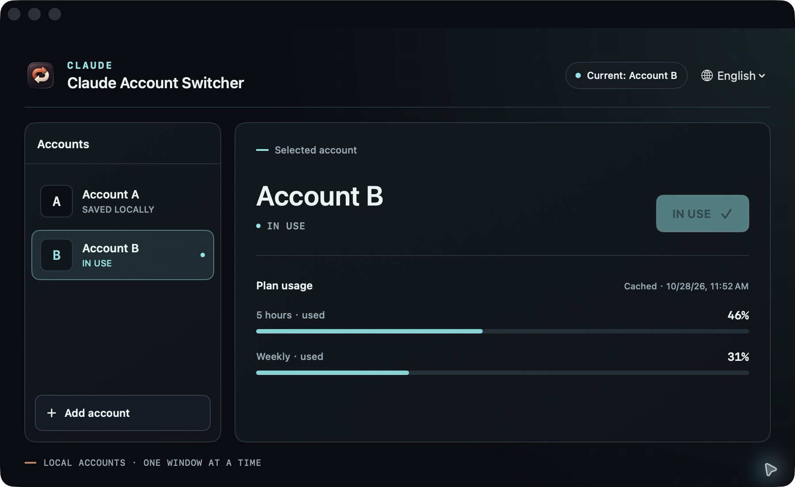

<p align="center"></p>

# Claude Account Switcher

A small, unofficial macOS app to switch between Claude Desktop accounts and keep local Code sessions visible. Each account is signed in separately; only one Claude window runs at a time.

[简体中文](docs/README.zh-CN.md) · [日本語](docs/README.ja.md) · [한국어](docs/README.ko.md) · [Español](docs/README.es.md) · [Français](docs/README.fr.md) · [Deutsch](docs/README.de.md)



*Usage percentages in the screenshot are illustrative.*

**Usage validation:** synthetic encrypted data and mocked account responses have been tested. Keychain permission and live usage with real signed-in accounts have not yet been verified.

The Desktop login format was researched with reference to [claude-usage](https://github.com/gipsic/claude-usage) (MIT).

## Install

Requires macOS, Claude Desktop in `/Applications`, Xcode Command Line Tools, and `/usr/bin/python3` 3.9 or later. Build locally:

```sh
git clone https://github.com/gjw199513/claude-account-switcher.git
cd claude-account-switcher
./install.sh
```

Open **Claude Account Switcher** from `~/Applications`. The interface follows the macOS language, with English, Simplified Chinese, Japanese, Korean, Spanish, French, and German available.

Use the language menu in the upper-right corner to choose a language or follow the system. To read plan usage, select an account and choose **Refresh**. The first read explains the access and macOS may ask for permission to use Claude Safe Storage in Keychain. It uses that account’s existing Claude Desktop login; no separate login or model request is needed. The app decrypts the Desktop access token briefly in memory and sends it only to `api.anthropic.com` over HTTPS; it does not save, log, or refresh credentials. After a successful first read, accounts are checked about every 15 minutes while macOS is logged in; manual refreshes have a five-minute cooldown. Bars show the last read five-hour and weekly percentages, not token counts. Readings older than 30 minutes or past their reported reset are hidden. An inactive account’s token may expire until the account is opened in Claude again. The Desktop credential format and usage endpoint are undocumented and can change or be rate-limited.

## Use

1. Your current Claude profile is **Account A**. Click **Add account**, confirm the switch, and sign in to the new account in Claude. Open its **Code** tab.
2. On the first login, quit Claude with `⌘Q`, then select that account and click **Switch** once more to load the shared session list.
3. Later, select an account and click **Switch**. Claude closes normally, the local session index is reconciled automatically, and the selected account opens. Finish or save active work before switching.

Additional accounts can be added the same way. Login expiration may still require signing in again.

## How it works and limits

- Each profile has its own Claude data directory. Switching never moves or replaces credentials; usage reads use the Desktop token as described above. The app does not switch accounts based on quota.
- Local Code transcripts remain in the shared `~/.claude/projects` directory. A background task and the switch operation reconcile account-specific sidebar index files. Claude may need a restart to reload its list.
- Claude cloud chats, Cowork sessions, account quotas, and account-specific connectors are separate. Connectors are not copied between accounts. Desktop-specific settings are not merged.
- SSH, WSL, custom worktrees and other special or unrecognized sessions may be skipped. Existing local scratch workspaces keep their original paths; deleting a profile directory can break sessions that use it. Multiple organization folders stop automatic sync instead of guessing.
- Conflicting or malformed records are preserved; overwritten index records are backed up locally. Deletions are not propagated. This relies on Claude Desktop's undocumented storage layout and may break after updates.

**Validation:** the current macOS installation displayed Account A's local Code sidebar in Account B. Synthetic tests cover multi-account reconciliation and safety checks. Continuing a real conversation across accounts and other Claude versions has not yet been fully validated.

## Optional local warm-up

Install [Claude Code CLI](https://code.claude.com/docs/en/setup) (version 2.1.268 or newer). Select an account, open **Warm-up → Settings**, and use **Sign in** to complete the official CLI login for that account. Choose **Refresh**, confirm the displayed email belongs to the selected desktop account, then enable the schedule and choose a time. Each account has its own isolated CLI configuration; this app does not read or copy CLI credentials.

The macOS background agent sends one short Haiku request at the chosen time while you are logged in, even if the window is closed. If the Mac was asleep or off at that time, opening the app later the same day prompts before sending. Failed requests are not automatically retried that day. Requests consume quota and can incur usage-credit charges; they do not guarantee a new five-hour window.

## Uninstall

Run `./uninstall.sh`. Claude profiles, conversations, and local backups remain on disk.

## License

[MIT](LICENSE). This project is independent and is not affiliated with or endorsed by Anthropic.
